# Sentinel: Autonomous Cloud Security Governance Platform (SOAR)

[](https://www.terraform.io/)
[](https://aws.amazon.com/)
[](https://csrc.nist.gov/pubs/sp/800/53/r5/upd1/final)
[](https://aws.amazon.com/sns/)
[]()

## Executive Summary
In highly regulated industries (Finance, Gov, Healthcare), the **"Window of Vulnerability"**—the time between a misconfiguration and its remediation—is the single biggest predictor of a breach. Manual auditing cycles are insufficient to stop automated bots scanning for open ports.

**Sentinel** is an enterprise-grade Security Orchestration, Automation, and Response (SOAR) platform engineered to close this window. It moves security from a "Gatekeeper" model to a "Guardrails" model, autonomously detecting, remediating, and auditing high-risk configuration drift in **< 60 seconds**.

---

## 🏛️ Architecture & Data Flow

Sentinel moves beyond static auditing by acting as an "Immune System" for the cloud. It detects threats in real-time, surgically removes them, and broadcasts the incident to stakeholders.

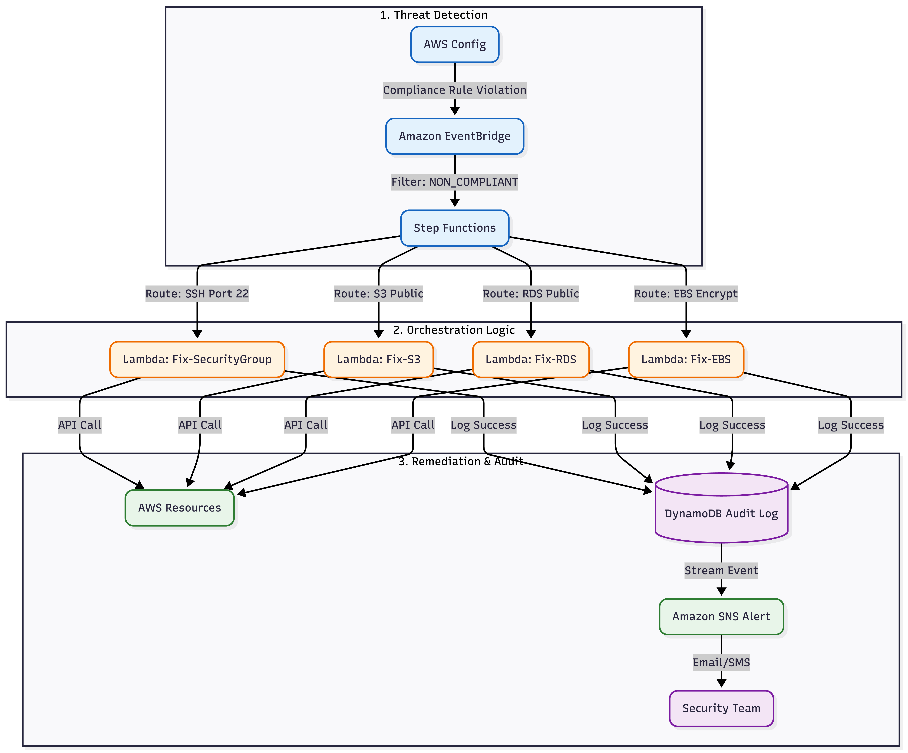

### **The Workflow**
1.  **Detect:** AWS Config evaluates resources against CIS Benchmarks.
2.  **Trigger:** EventBridge captures `NON_COMPLIANT` events.
3.  **Orchestrate:** Step Functions identifies the threat vector (Network vs Storage vs Database).
4.  **Remediate:** Lambda functions execute surgical API calls to revert the configuration.
5.  **Audit:** DynamoDB logs the action; SNS alerts the SecOps team.


---

## 📂 Repository Structure

This project follows a modular structure to separate Infrastructure as Code (Terraform) from Application Logic (Python) and Documentation Assets.

```bash
aws-sentinel-soar/
├── lambda/                          # Remediation Logic (Python/Boto3)
│   ├── fix_sg.py                    # Network Security Logic
│   ├── fix_s3.py                    # Storage Security Logic
│   ├── fix_rds.py                   # Database Security Logic
│   └── fix_ebs.py                   # Compliance Logic
├── terraform/                       # Infrastructure as Code
│   ├── main.tf                      # Core resources (Step Functions, DDB, SNS)
│   ├── iam.tf                       # Least Privilege Roles
│   ├── lambda.tf                    # Function Configuration
│   └── variables.tf                 # Region & Account variables
├── events/                          # EventBridge Schemas
├── screenshots/                     # Evidence Artifacts
│   ├── main_evidence/               # High-level overview (Architecture, Dashboard)
│   └── modules/                     # Detailed per-module walkthroughs
└── README.md                        # Documentation

```

## 🛡️ Threat Modeling & Compliance Mapping

This framework targets high-severity controls found in **UK Cyber Essentials Plus** and **NIST 800-53**.

| Threat Vector | Risk Scenario | Remediation Module | Compliance Control |
| :--- | :--- | :--- | :--- |
| **Network Intrusion** | SSH (Port 22) open to `0.0.0.0/0`. | **Network Sentinel:** Instantly revokes ingress rule. | **NIST AC-4** |
| **Data Leakage** | S3 bucket set to "Public Read". | **DLP Sentinel:** Enforces "Block Public Access". | **GDPR Art. 32** |
| **Ransomware** | S3 Versioning disabled. | **Resilience Sentinel:** Forces Versioning `Enabled`. | **CIS 1.10** |
| **Database Exposure** | RDS instance launched publicly. | **Database Sentinel:** Disables Public IP. | **PCI-DSS 1.3** |
| **Unencrypted Data** | EBS volumes created unencrypted. | **Encryption Sentinel:** Enforces Encryption. | **NIST SC-28** |


---

## 🔐 Security Architecture & IAM Strategy

A core tenet of this project is **Least Privilege**. Permissions are decoupled to minimize the blast radius.

| Role Name | Purpose & Permissions |
| :--- | :--- |
| **`Sentinel-Remediation-Role`** | **The Enforcer.** Granted specific API permissions to modify resources (`ec2:RevokeSecurityGroupIngress`, `s3:PutBucketVersioning`) but cannot create new infrastructure. |
| **`Sentinel-StepFunctions-Role`** | **The Orchestrator.** Permitted only to invoke the specific remediation Lambda functions. |
| **`Sentinel-EventBridge-Role`** | **The Trigger.** Permitted only to `states:StartExecution` for the specific State Machine. |


---

## 📸 Evidence of Execution (Proof of Value)

The Sentinel framework provides complete visibility from detection to remediation.

### **1. Continuous Monitoring (AWS Config)**
*Sentinel continuously monitors 5 critical compliance rules across the AWS environment.*
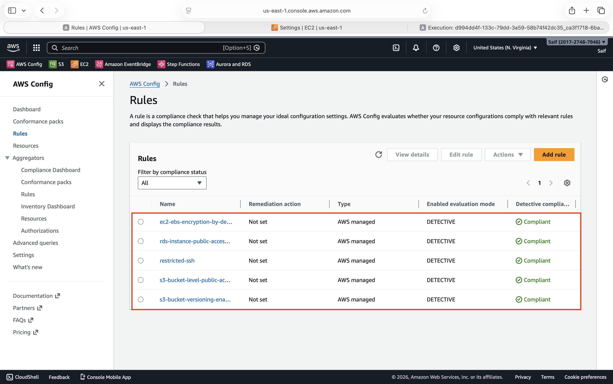

### **2. Event Triggering (EventBridge)**
*The EventBridge rule actively filters for `NON_COMPLIANT` status changes and instantly routes the event to the orchestration layer.*
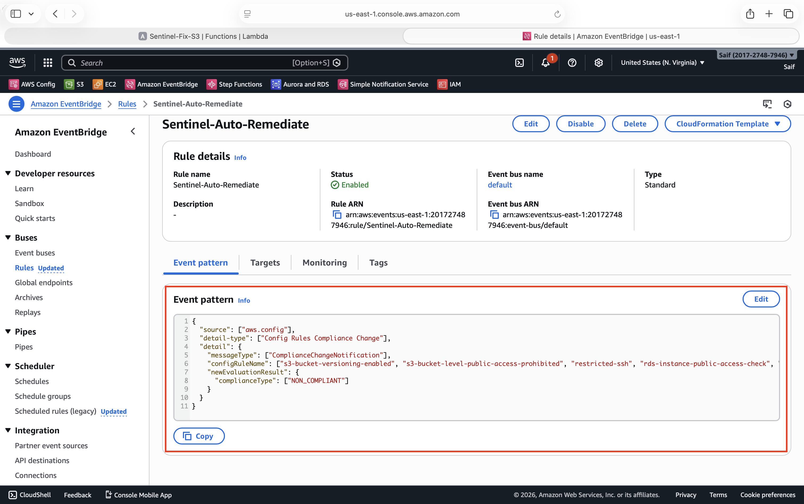

### **3. Automated Response (Step Functions)**
*Upon detection of a threat, the Orchestrator identifies the rule type and executes the specific remediation logic (Green Path).*
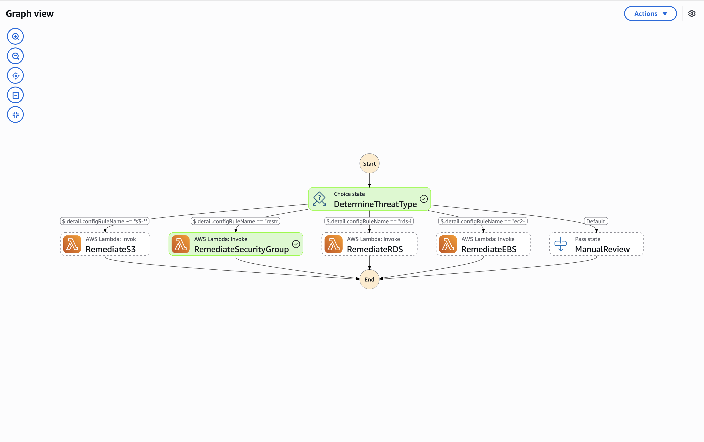

### **4. Immutable Audit Trail (DynamoDB)**
*Every automated action is logged with a timestamp, resource ID, and status for compliance auditing.*
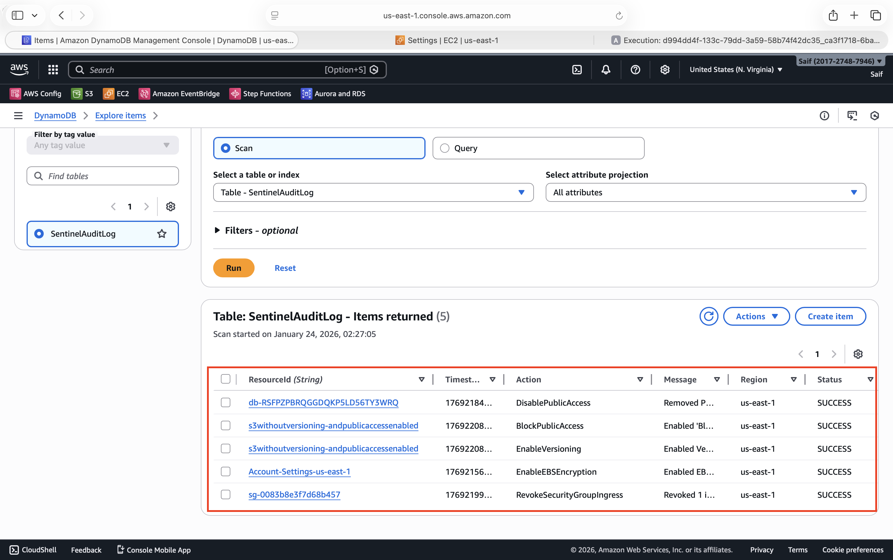

### **5. Real-Time Alerting (SNS)**
*Security teams are notified immediately via Email/SMS when a remediation occurs.*
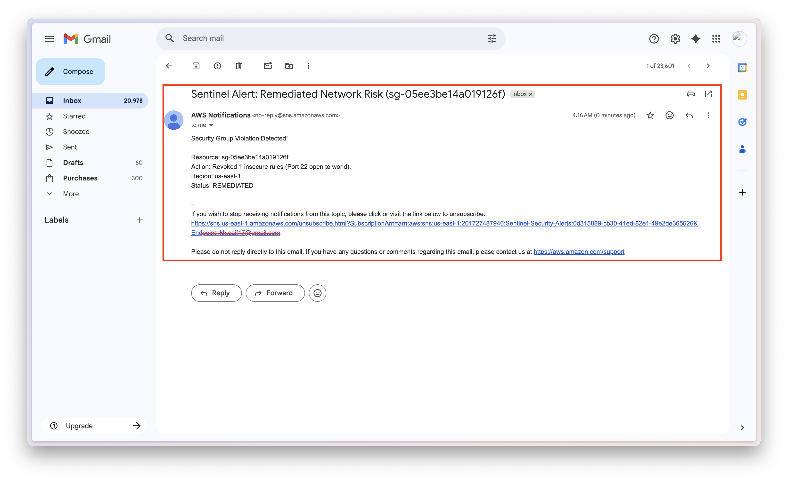


---

## 🔻 Detailed Remediation Walkthroughs

<details>
<summary><strong>Module 1: Network Security (SSH Port 22)</strong></summary>

<br>

**Scenario:** A developer manually created a Security Group allowing SSH traffic from `0.0.0.0/0`.

1.  **Threat:** High-risk Ingress rule created.
    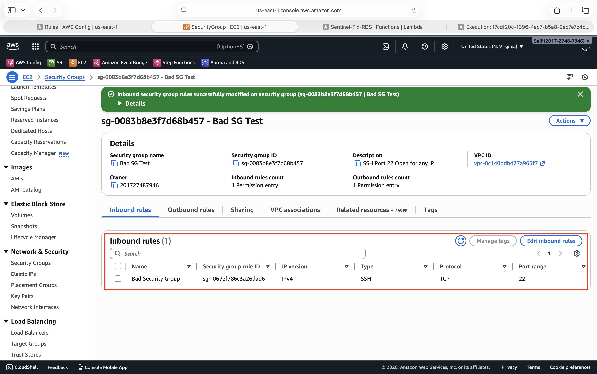
2.  **Detect:** AWS Config flags `restricted-ssh` as `NON_COMPLIANT`.
    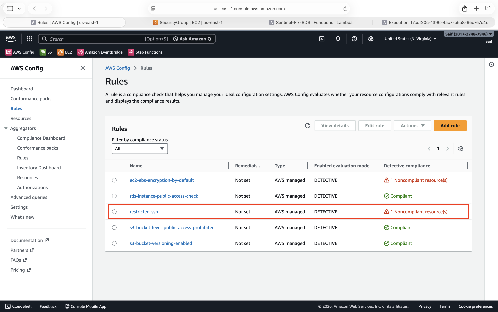
3.  **Fix:** Lambda revokes only the bad rule (leaving others intact).
    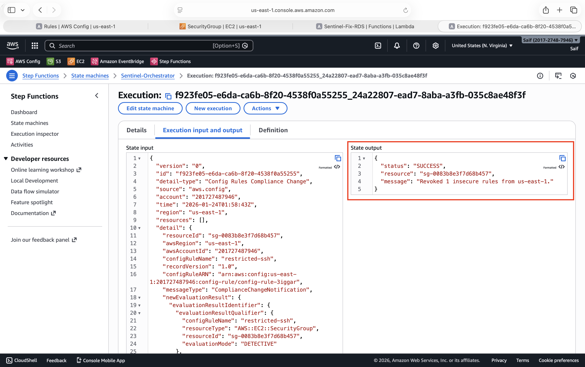

</details>

<br>

<details>
<summary><strong>Module 2: Storage Security (S3 Data Leak Prevention)</strong></summary>

<br>

**Scenario:** An S3 Bucket was created with "Block Public Access" disabled and Versioning turned off.

1.  **Threat:** Bucket policy allows public reads and bucket versioning is disabled.
    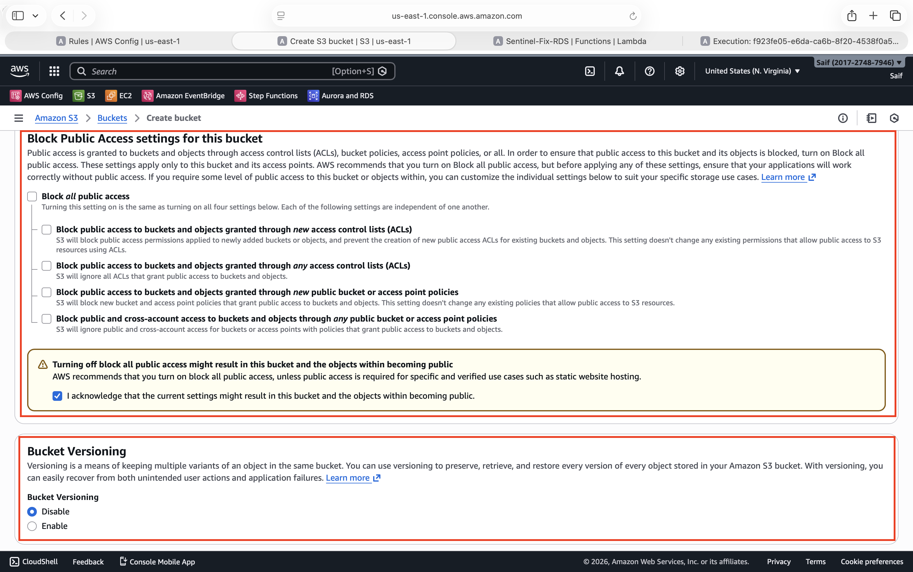
2.  **Result A:** Sentinel re-enabled "Block Public Access" immediately.
    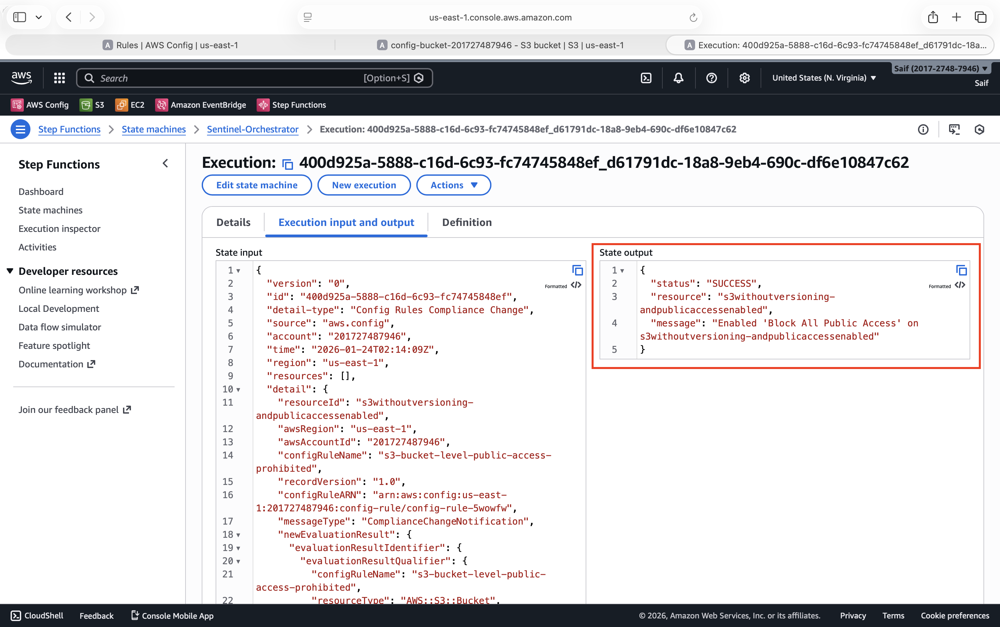
3.  **Result B:** Sentinel also enforced Bucket Versioning to prevent data loss.
    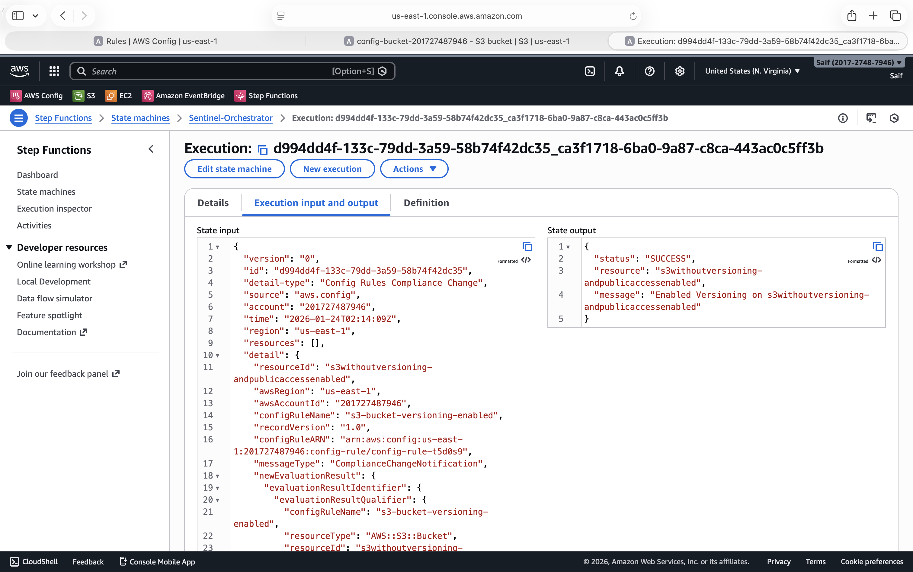

</details>

<br>

<details>
<summary><strong>Module 3: Database Security (RDS Public Access)</strong></summary>

<br>

**Scenario:** An RDS MySQL instance was launched with "Publicly Accessible: Yes".

1.  **Threat:** DB exposed to internet gateway.
    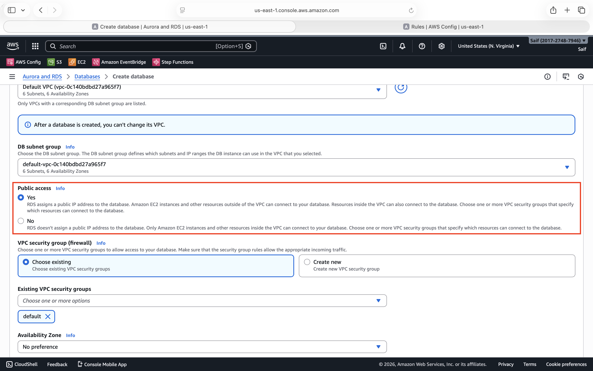
2.  **Fix:** Lambda triggers `ModifyDBInstance` to disable public access.
    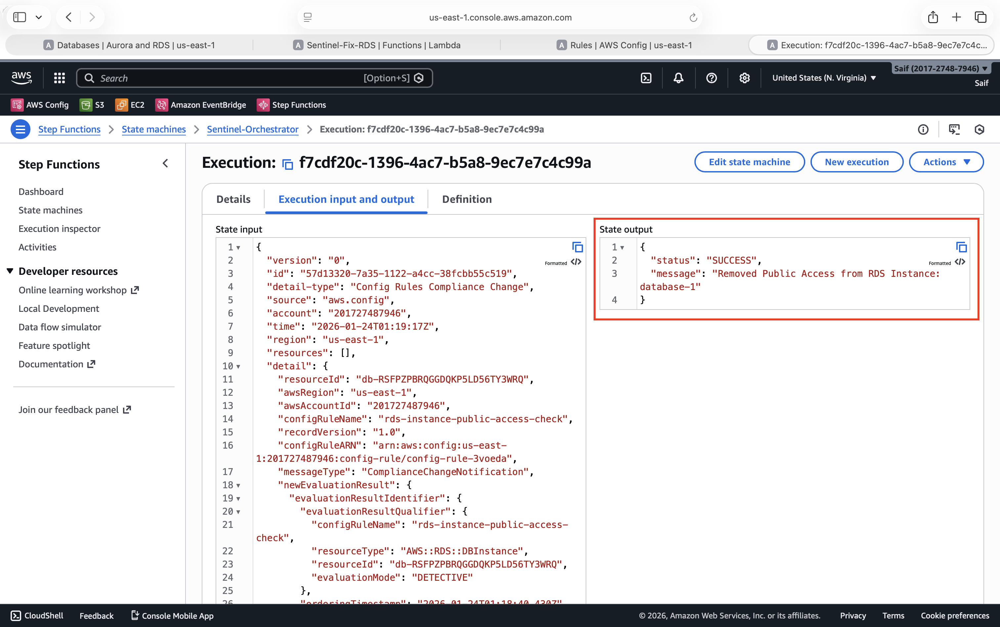

</details>

<br>

<details>
<summary><strong>Module 4: Compliance (EBS Encryption)</strong></summary>

<br>

**Scenario:** Account-level EBS Encryption by Default was disabled.

1.  **Threat:** Account attributes modified to allow unencrypted disks.
    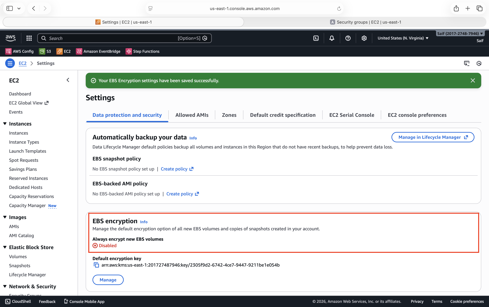
2.  **Fix:** Sentinel reverts setting to `Enabled`.
    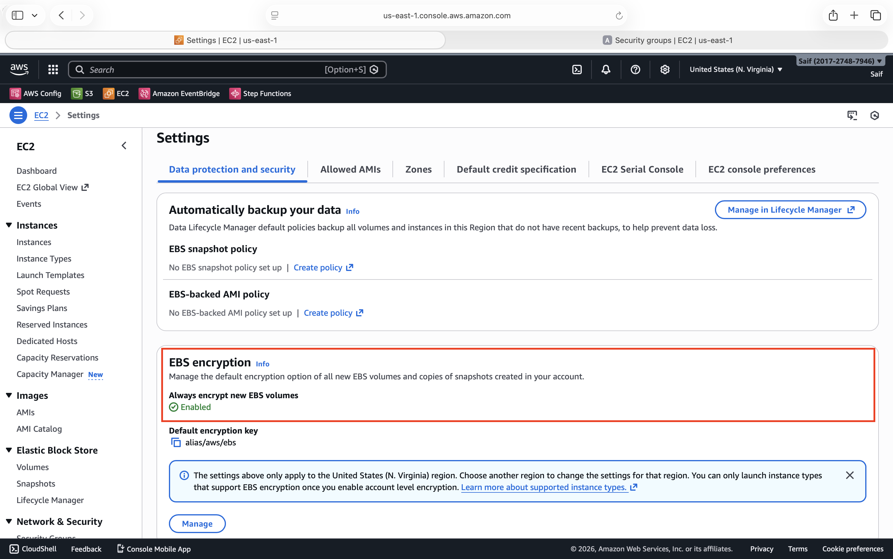

</details>


---

## 💰 Cost Analysis (FinOps)

This architecture utilizes a **Serverless / On-Demand** pricing model, ensuring near-zero cost when idle.

| Service | Pricing Dimension | Estimated Monthly Cost (Idle) | Estimated Monthly Cost (Active) |
| :--- | :--- | :--- | :--- |
| **AWS Config** | Per Rule Evaluation | $2.00 (varies by resource count) | $5.00+ |
| **Lambda** | Per 1M Requests | **Free Tier** | < $0.05 |
| **Step Functions** | Per State Transition | **Free Tier** | < $0.10 |
| **Amazon SNS** | Per 1k Notifications | **Free Tier** | < $0.01 |
| **Total** | | **~ $2.00 / month** | **~ $6.00 / month** |


---

## 🛠️ Deployment Instructions (Terraform)

**Prerequisites:**
* AWS CLI (Admin Access)
* Terraform v1.0+


***1. Clone Repository & Navigate:***

git clone [https://github.com/saif4224/AWS-Projects.git](https://github.com/saif4224/AWS-Projects.git)

cd AWS-Projects/aws-sentinel-soar/terraform

***2. Initialize & Plan:***

terraform init
terraform plan -out=tfplan

***3. Apply Infrastructure:***

terraform apply tfplan

***4. Subscribe to Alerts (Manual Step):***

Terraform creates the SNS Topic (Sentinel-Security-Alerts), but for privacy reasons, you must subscribe your email manually in the AWS Console and confirm the subscription link sent to your inbox.


---

## 👨‍💻 About the Author
**KHANDAKER SAIFUZZAMAN**

**Aspiring Cloud Security Engineer | AWS Certified Solutions Architect - Associate** | 

**MSc Cybersecurity (United Kingdom)** | **CompTIA Security+ Certified**

I specialize in bridging the gap between **Security Policy** and **DevOps Automation**. This project demonstrates my ability to build self-healing infrastructure that adheres to financial-grade compliance standards (NIST/GDPR).

[Connect on LinkedIn](https://www.linkedin.com/in/khandakersaifuzzaman) 
